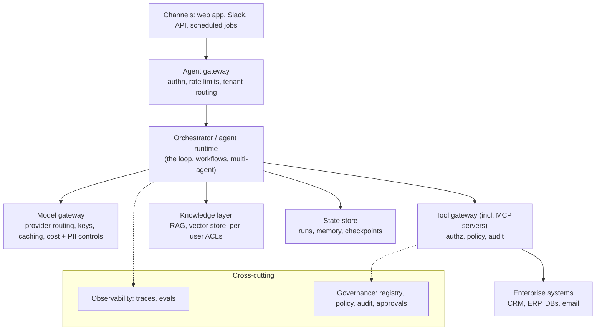

# Enterprise agent architecture

> Same agent loop as always, wrapped in layers so a company can control, observe and pay for it.

**Practice:** [`practice/tool_gateway.py`](practice/tool_gateway.py)

## 1. The layers



| Layer | Job | Enterprise question it answers |
|---|---|---|
| Agent gateway | Single entry; auth, quotas, tenant isolation | "Who is calling, and are they allowed?" |
| Orchestrator | Runs the loop and workflows | "What can it do, in what order?" |
| Model gateway | One place to call LLMs | "Which models, whose keys, what does it cost, does PII leave?" |
| Tool gateway | Every tool/MCP call passes through it | "What can the agent touch? Is it logged?" |
| Knowledge layer | Retrieval with the *user's* permissions | "Can it leak documents the user can't see?" |
| State store | Runs, memory, checkpoints | "Can we resume, replay, delete on request?" |
| Observability | Traces, evals, alerts | "Is it working, and how do we know?" |
| Governance plane | Agent registry, policies, approvals, audit | "Who owns it, is it approved, what did it do?" |

## 2. Three ideas worth remembering

- **Gateways beat per-agent code.** Put auth, limits and logging in one tool gateway and one model
  gateway. Fix a rule once, every agent gets it. Hand-rolled checks scattered across agents drift.
- **Agent registry.** A list of every agent: owner, purpose, tools, data it touches, model, risk tier,
  status. You can't govern what you can't list. ("Shadow agents" are the new shadow IT.)
- **Tenant and data isolation.** Retrieval and memory must filter by tenant/user *before* the model sees
  anything. A prompt saying "don't show other customers' data" is not isolation.

## 3. MCP in the enterprise

MCP standardises how agents connect to tools. In an enterprise, don't let agents connect to arbitrary
MCP servers: run an approved internal catalogue, route calls through the tool gateway, and treat tool
descriptions and results from third-party servers as untrusted input.

## 4. Build vs buy (what to hand-roll)

Hand-roll the *concepts* once so you understand them (the practice script). In production you'll
usually adopt an API gateway, a secrets vault, OpenTelemetry, and a policy engine (e.g. OPA) rather
than writing them.

## Try it

```bash
python practice/tool_gateway.py
```

Every call is checked for registration, scope, and rate limit, and **every attempt is audited**,
including denials.
