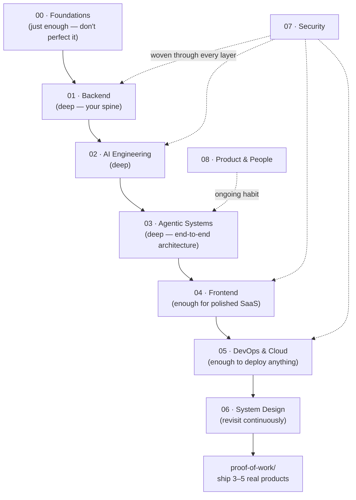

# AI Product Engineer — Mastery Roadmap

Building from the foundational level up to shipping **any** AI‑integrated product end to end:
backend, frontend, and production agentic AI systems.

- **Starting point:** Agentic AI Engineer — foundation‑level ML / DL / NLP / GenAI / agents.
- **Target:** AI full‑stack product engineer — design, build, deploy, and operate a real product,
  and reason about the trade‑offs at every layer.
- **Method:** learn one concept → implement it in a real backend/frontend/agent → commit here → post the artifact on X. Repeat daily.

> This repo *is* the progress tracker. Every topic is a file. Filling a file in, checking its box in
> [`PROGRESS.md`](PROGRESS.md), and committing is one unit of progress.

---

## Target depth: level 4 of 5

Not "write the book on it." **Level 4 = build‑and‑ship competence:**

| Level | Meaning |
|---|---|
| 1 | Heard of it. |
| 2 | Can follow a tutorial with it. |
| 3 | Can use it when someone sets it up. |
| **4** | **Can implement it from scratch when a project needs it, debug it, and explain the trade‑offs.** ← the goal for most topics |
| 5 | Deep specialist — could give a conference talk. Aim here for **backend + AI/agents only.** |

For every topic file, "done" means: *I can implement this from memory and explain why I'd choose it.*
That's the bar for checking the box.

---

## How this repo is organized

Folders are numbered for reading order, not priority. Each domain folder has its own `README.md`
with the detailed checklist, mini‑projects, and a "done when" bar.

| # | Domain | Depth | What it covers |
|---|---|---|---|
| `00` | [foundations](00-foundations/) | L3 → move on | How a computer works, one language (Python) deep, data structures, algorithms, concurrency, engineering practice |
| `01` | [backend](01-backend/) | **L4–5** | HTTP, FastAPI, Postgres + SQLAlchemy, Redis, auth, file storage, async & workers, production hardening |
| `02` | [ai-engineering](02-ai-engineering/) | **L4–5** | LLM APIs, prompting, structured output & tools, embeddings & vector search, RAG, evaluation, multimodal, fine‑tuning basics |
| `03` | [agentic-systems](03-agentic-systems/) | **L4–5** | Agent loop, orchestration, human‑in‑the‑loop, reliability, observability, deployment, an end‑to‑end reference architecture |
| `04` | [frontend](04-frontend/) | L4 | HTML/CSS/Tailwind, JS, TypeScript, React, Next.js, app patterns (streaming/optimistic UI) |
| `05` | [devops-cloud](05-devops-cloud/) | L4 | Linux, Docker, Nginx, CI/CD, AWS, Terraform, observability |
| `06` | [system-design](06-system-design/) | L4, ongoing | Scaling, data, distributed systems, resilience, architecture, case studies |
| `07` | [security](07-security/) | L4, woven in | OWASP Top 10, web attacks, auth security, crypto & secrets, hardening |
| `08` | [product-and-people](08-product-and-people/) | L3, ongoing | Product thinking, UI/UX polish, working with humans, the long game |

Support folders:

| Folder | Purpose |
|---|---|
| [`projects/`](projects/) | The build ladder — 11 projects, each teaching one or two new concepts. |
| [`proof-of-work/`](proof-of-work/) | Production‑grade SaaS builds, write‑ups, benchmarks — the portfolio. |
| [`logbook/`](logbook/) | Daily "today I learned" entries + X post drafts + weekly reviews. |
| [`resources/`](resources/) | Books, courses, docs, papers. |

---

## Recommended sequence



You said *backend → frontend → agentic AI*. One tweak: do **AI engineering and agentic systems
right after backend**, since agentic systems are backend systems with an LLM in the loop — then
frontend. Frontend before agents is fine too; the folders are independent, pick your order.
**Security is not a phase** — read the relevant `07-security/` file whenever you build the thing it protects.

---

## Timeline

Depends entirely on hours/week. Two honest tracks to level 4:

| Track | Hours/week | Calendar | Notes |
|---|---|---|---|
| Focused | 30–40 | ~5 months | Near full‑time. Foundations compressed, projects run in parallel. |
| Sustainable | 12–15 | ~10–12 months | Evenings + weekends. The daily loop is what makes this work. |

Rough per‑domain budget on the sustainable track:

| Domain | Weeks | |
|---|---|---|
| 00 foundations | 3–4 | Stop at "not mystified." Come back when something bites. |
| 01 backend | 8–10 | Go deep. Every other domain leans on this. |
| 02 ai-engineering | 5–6 | Deep. |
| 03 agentic-systems | 4–5 | Deep. Ends with a written reference architecture. |
| 04 frontend | 4–5 | Working knowledge — ship a real UI, don't chase mastery. |
| 05 devops-cloud | 3–4 | Deploy one project properly, reuse the setup. |
| 06 system-design | 3–4 | Then revisit one case study a week, forever. |
| 07 security | ~2 | Spread across the others + one focused pass. |
| 08 product-and-people | ongoing | ~1–2 concentrated weeks, rest by osmosis. |

---

## The daily loop

1. **Learn** one concept (one topic file).
2. **Implement** it — in a project under `projects/`, or as a runnable snippet next to the topic file.
3. **Write** the topic file: notes, the questions you can now answer cold, "done when," links.
4. **Commit** (see convention below).
5. **Post** the artifact on X + push to GitHub — code, a diagram, or a benchmark. One sentence of what you learned.
6. Update the box in [`PROGRESS.md`](PROGRESS.md).

Progress is *not* "finished a course." Progress is this loop, most days.

### Git conventions

- **Branch** per project or per domain sprint: `backend/fastapi-auth`, `ai/rag-api`, `learn/concurrency`.
- **Commit message:** `<area>: <what changed>` — e.g. `backend/auth: JWT refresh-token rotation`, `notes(rag): chunking strategies comparison`.
- Keep the box in `PROGRESS.md` honest. `[~]` while learning, `[x]` only when you could rebuild it from memory.
- Weekly: fill a [`logbook/`](logbook/) weekly review, tag a checkpoint if a project shipped.

---

## Getting started

```bash
cd d:/SDE
git init -b main
git add -A
git commit -m "chore: scaffold AI Product Engineer roadmap"
# then create an empty repo on GitHub and:
git remote add origin git@github.com:<you>/<repo>.git
git push -u origin main
```

Then open [`00-foundations/README.md`](00-foundations/README.md) and start the loop.

---

## Books (read alongside, not before)

- **Designing Data‑Intensive Applications** — Kleppmann. The backbone of domains 01, 05, 06.
- **Clean Architecture** — Martin. Boundaries and dependency rules.
- **The Pragmatic Programmer** — Hunt & Thomas. The habits.
- **Database Internals** — Petrov. What Postgres/Redis are doing underneath.
- **Web Scalability for Startup Engineers** — Ejsmont. Practical scaling for small teams.

Full list with the why: [`resources/README.md`](resources/README.md).
